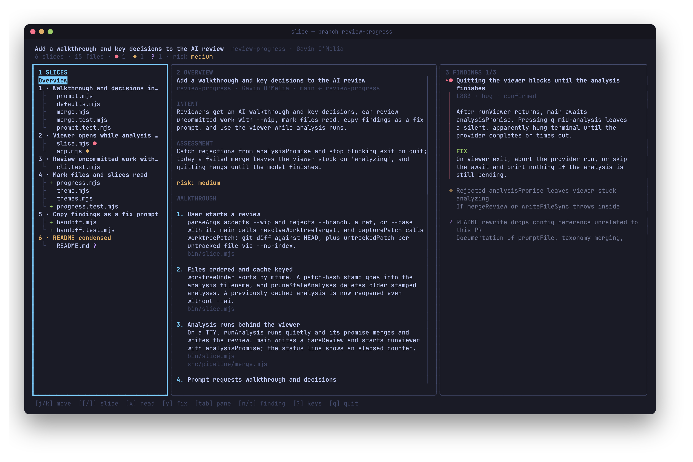
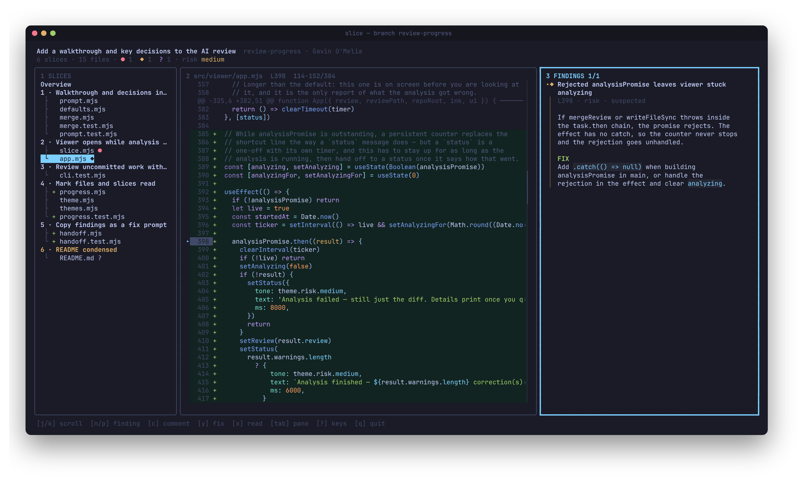
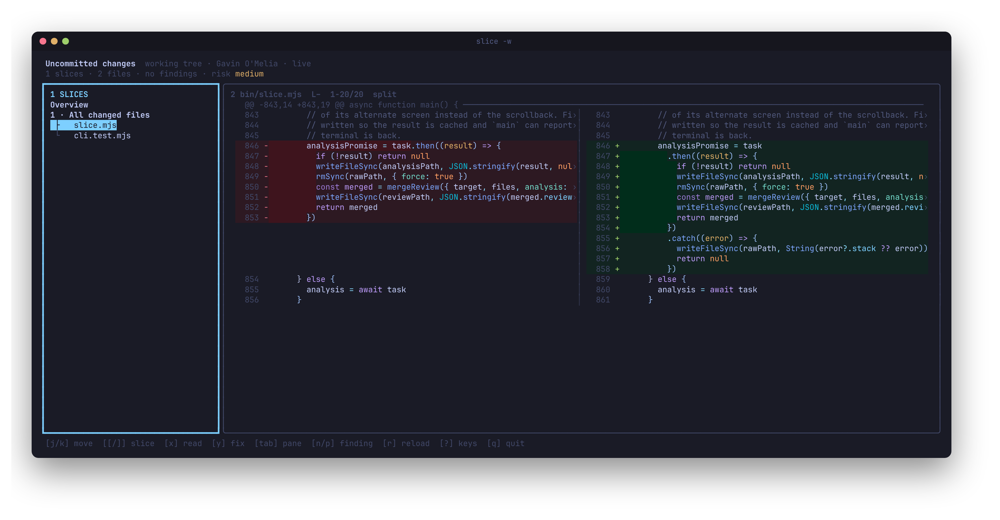

# slice

[](https://github.com/gavinomelia/slice/actions/workflows/ci.yml)
[](LICENSE)

Review pull requests in your terminal, one behavioral slice at a time.

slice groups a diff by what each change does — the migration, model,
controller, view, and spec that make one feature work — instead of by
directory. Add `--ai` and Claude Code reads your repo to explain the change,
walk you through it, and flag problems on the lines where they occur.



## Why slice

- **Review work before it's pushed.** `slice -w` shows your uncommitted
  changes and updates live as you or an agent edit, so you can review as the
  work happens, not after a PR exists.
- **The analysis sits next to the code.** Slices, a walkthrough, key
  decisions, and findings appear beside the diff they describe. You never
  have to switch between a chat window and the code.
- **Keyboard first.** Every action is a key or two away: move between
  slices, jump between findings, mark files read, switch to split view.
- **Finish the review where you started it.** Comment on lines, then
  approve, comment, or request changes, all posted to GitHub without
  opening a browser.



## Install

```
npm install -g @gavinomelia/slice
```

```
pnpm add -g @gavinomelia/slice
```

Requires Node 22+, macOS or Linux (Windows via WSL), and the
[GitHub CLI](https://cli.github.com), authenticated. `--ai` also needs
[Claude Code](https://claude.com/claude-code). No API key is needed: the
analysis runs through your existing Claude Code session.

## Usage

```
slice              # the PR for the current branch, or the branch diff
slice 1679         # PR #1679
slice my-branch    # that branch's PR, or the branch diff if it has none
slice --branch     # the local branch against its base, ignoring any PR
slice -w           # uncommitted work, updated live as files change
slice --ai         # add the AI review: slices, walkthrough, findings
slice -p "..."     # the AI review, with an extra instruction for this run
```

By default, slice opens the diff without running a model. Once `--ai` has
analyzed a review, running `slice` again reopens that analysis.
`--refresh` runs it again.



## Keys

Press `?` in slice to see every key. The essentials:

| Key | Action |
|---|---|
| `1` `2` `3` `tab` | focus slices / diff / findings |
| `j` `k` `↑` `↓` | move; `space` `b` page |
| `h` `l` `←` `→` | scroll the diff sideways; `0` back to the start |
| `[` `]` | previous / next slice |
| `n` `p` | next / previous finding |
| `v` | toggle unified / split diff |
| `z` | zoom the diff to full screen |
| `x` | mark the file, or the whole slice, as read |
| `c` | comment on the cursor line (`H` `L` pick the side in split view) |
| `s` `A` `R` | submit as comment / approve / request changes |
| `y` `Y` | copy findings here, or all of them, as a fix prompt |
| `r` | reload (`-w`; it also reloads on its own) |
| `?` | show all keys |
| `q` | quit |

`c`, `s`, `A`, and `R` open `$EDITOR`. Drafts are kept until you submit
them, and saving an empty file cancels. `y` copies a prompt you can hand to
any coding agent.

## How the AI review works

Claude Code reads your repo with read-only tools (`Read`, `Grep`, `Glob`),
so it can follow callers and check your conventions
(`.github/instructions/*.md`, `docs/CONVENTIONS.md`) rather than judging the
diff in isolation. Each finding is checked against the patch. Findings that
point outside the diff are dropped or demoted.

A PR is someone else's input, so the analysis gets no write, execute, or
network tools. A repo's config can't change that. Only your own config can.

## Configuration

```
slice --init-config        # .slice.jsonc in the repo: how code is reviewed
slice --init-config user   # ~/.config/slice/config.jsonc: how slice looks
slice --print-config       # the resolved config and where it came from
```

```jsonc
// .slice.jsonc — committed with the repo
{
  "review": {
    "slicing": "Treat anything under db/migrate as its own slice.",
    "instructions": "Ignore anything under vendor/.",
    "severities": { "nit": null }
  }
}
```

```jsonc
// ~/.config/slice/config.jsonc — yours only
{
  "review": { "model": "opus", "effort": "medium" },
  "theme": { "preset": "dark", "syntax": "tokyo-night" },
  "layout": { "diffView": "split" }
}
```

Config is JSONC rather than JavaScript, so checking out a branch can never
run code. `allowedTools`, `promptFile`, `provider`, `model`, and `effort`
are only read from your own config. slice warns if a repo tries to set them.

## Cache

Patches, analyses, drafts, and read marks live in
`$XDG_CACHE_HOME/slice/` (default `~/.cache/slice/`), never in the repo.
`slice --clear-cache` removes them. `slice --open <file>.review.json`
reopens a cached review without git or a model.

## Development

```
npm install
npm test          # node:test
npm run format    # prettier
```

`bin/slice.mjs` resolves the target and runs the analysis,
`src/pipeline/` is the only code that talks to `gh`, `git`, or the model,
`src/viewer/` is the terminal UI ([Ink](https://github.com/vadimdemedes/ink)),
and `src/config/` holds the defaults, themes, and config loader. Set
`SLICE_DEBUG=1` to see stack traces.

## License

MIT
