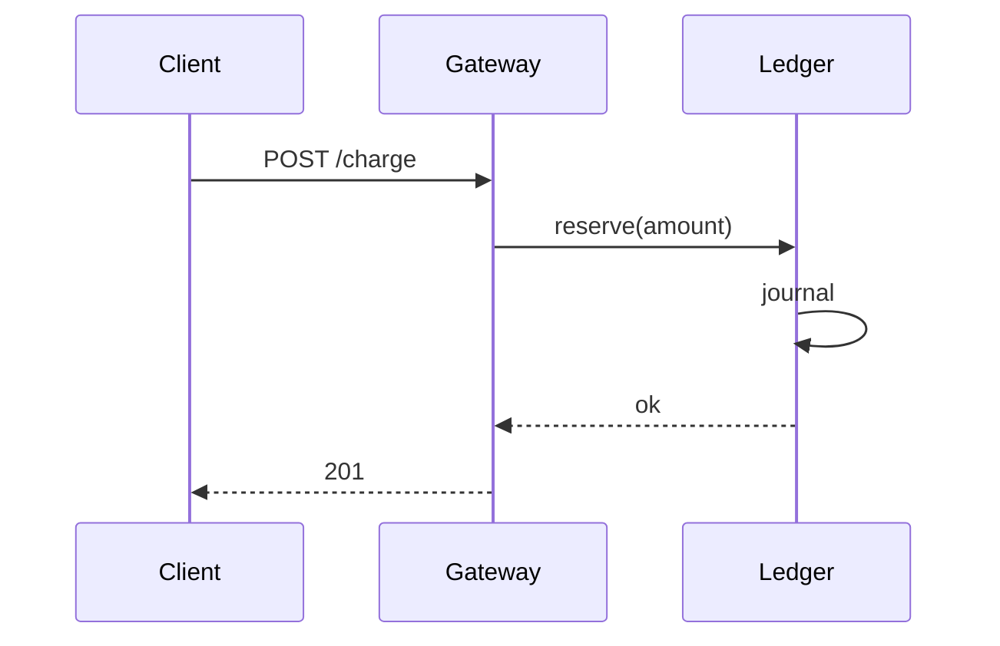
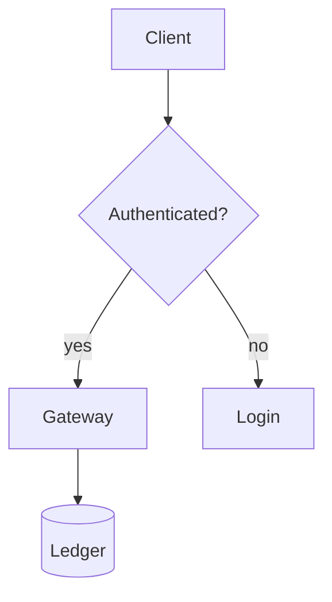
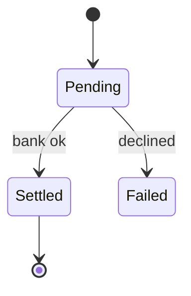
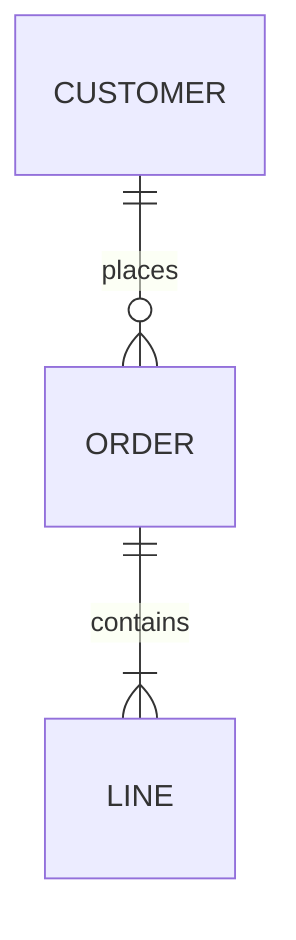
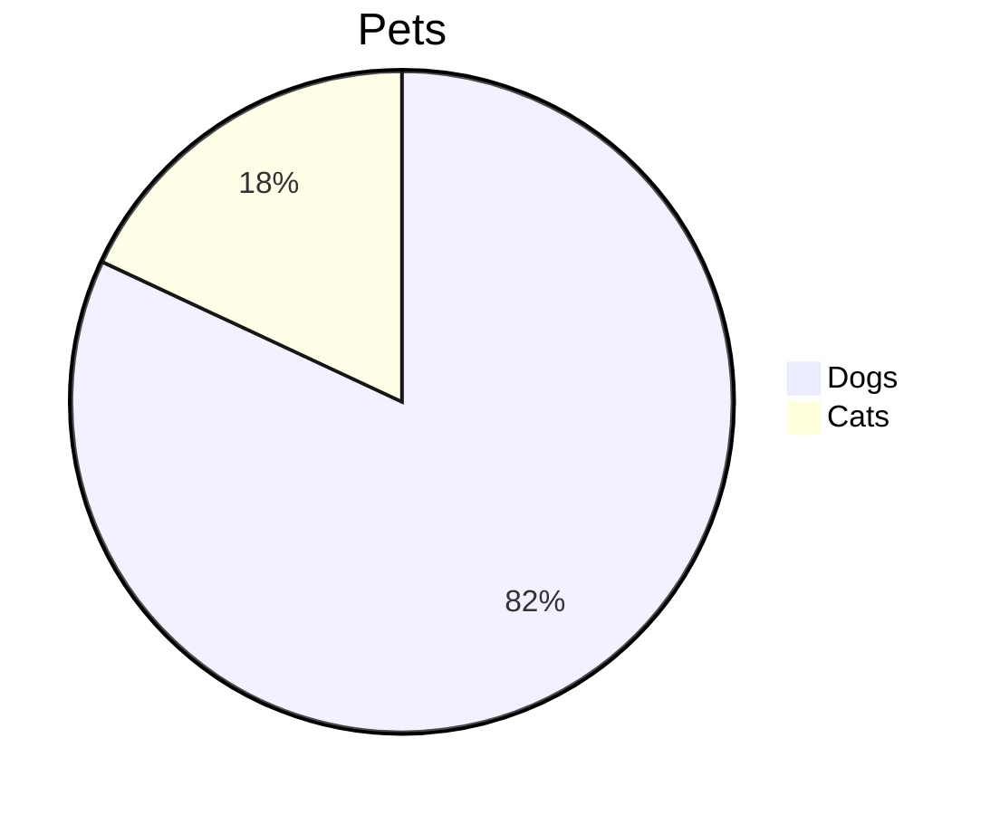

<!-- This comment must never be visible. -->

Payments Platform Handbook
==========================

[](https://example.com/ci) [](https://example.com/cov)

> **Status:** reviewed. See the [changelog][log] and the [runbook](#runbook "Jump to the runbook").

Table of contents
-----------------

1. [Overview](#overview)
2. [Architecture](#architecture)
   1. [Services](#services)
   2. [Data flow](#data-flow)
3. [Runbook](#runbook)
4. [Security](#security)

---

## Overview

The platform settles *card*, **bank**, and ***wallet*** payments. Amounts are integers, so 2 * 3 * 4 stays literal,
and snake_case_names and __dunder__ style are handled. Use `code with `` backticks`` and ~~strike~~ too.
This line has a hard break
and this one uses a backslash\
and this line ends the paragraph. Entities: &amp; &copy; &lt;tag&gt; &#35; and escapes: \*not bold\* \[not link\].

Autolinks: <https://example.com/autolink> and <mailto:ops@example.com>, a bare https://example.com/bare link, and raw <b>inline html</b>.

### Glossary with a very long heading that should certainly wrap around in a narrow pane because it just keeps going and going

Term
: Definition lists are not CommonMark, so this renders as a paragraph.

## Architecture

### Services

| Service | Language | Owner | SLO | Notes |
|:--------|:---:|---:|-----:|-------|
| `api-gateway` | Go | **platform** | 99.99% | Terminates TLS, rate limits, and routes requests to everything behind it |
| `ledger` | Rust | *finance* | 99.99% | Double entry; see [the design](https://example.com/ledger) |
| `risk` | Python | ~~ml~~ risk | 99.5% | Pipes \| must be escaped \| in cells |
| `notify` |  |  |  | Empty cells above |

| Only one column |
|-----------------|
| lonely |

### Data flow



Nested structure, four levels deep:

- Ingest
  - Validate
    - Schema
      - Reject with a 422, and include a long explanation of which field failed so that this deeply nested item has to wrap in the pane
    - Idempotency key
  - Enqueue with a dead letter queue

    A second paragraph inside a list item, separated by a blank line.

    ```sql
    SELECT id, amount FROM charges WHERE status = 'pending' AND created_at < now() - interval '5 minutes';
    ```

    > A quote inside a list item.
    >
    > - with its own list
    >   1. and a numbered child

- Settle
  1. Batch
  2. Reconcile
     - Compare to the bank file
     - Flag mismatches

Task list:

- [x] Write the design
- [x] Load test to 10k TPS
  - [ ] Soak for 24 hours
- [x] ~~Migrate to Kafka~~

Numbering that starts elsewhere:

7. seven
8. eight
9. nine

> Level one quote with `code` and a [link](https://example.com).
>
> > Level two quote.
> >
> > > Level three quote, long enough to wrap around inside the pane and show the bars stacking up neatly on each line of it.
>
> ```bash
> kubectl rollout status deploy/api-gateway
> ```

## Runbook {#runbook}

### Failover

```bash
#!/usr/bin/env bash
set -euo pipefail
region="$1"
aws route53 change-resource-record-sets --hosted-zone-id Z123 --change-batch "file://failover-$region.json" --profile payments-production --region us-east-1
```

```ts title="retry.ts" {3,5}
export async function retry<T>(fn: () => Promise<T>, attempts = 3): Promise<T> {
  for (let i = 0; i < attempts; i++) {
    try { return await fn() } catch (error) { if (i === attempts - 1) throw error }
    await sleep(2 ** i * 250)
  }
  throw new Error('unreachable')
}
```

```rust
fn main() { println!("{}", "hello"); }
```

```json
{ "retries": 3, "regions": ["us-east-1", "eu-west-1"], "enabled": true }
```

```
A fence with no language at all.
	A tab-indented line inside it.
```

~~~python
print("tilde fence")
~~~

````markdown
A four-backtick fence holding a fake one:
```js
not.really.code()
```
````

    An indented code block,
      with relative indentation kept.

### Escalation

<details>
<summary>Who to page</summary>

1. On-call SRE
2. Payments lead

</details>

<table><tr><td>A raw HTML table</td></tr></table>

### Internationalisation

| Locale | Greeting | Currency |
|---|---|---|
| ja-JP | こんにちは世界 | ¥1,000 |
| ar-SA | مرحبا بالعالم | ر.س |
| emoji | Ship it 🚀🚀 | 💶 100 |
| de-DE | Grüße | 1.000,00 € |

日本語の段落です。これは長い段落で、折り返しの動作を確認するためのものです。全角文字が正しく扱われるかどうかを見てください。

Footnotes[^1] are not CommonMark either[^note].

[^1]: So this is a plain definition.
[^note]: And so is this.

Math: $e^{i\pi} + 1 = 0$ and a line with a very long unbroken token: https://example.com/this/is/a/really/long/url/that/has/no/spaces/in/it/whatsoever/and/keeps/going/and/going/until/it/must/break

Setext two
----------

* * *

___

## Security

All card data is **tokenised** before it reaches `ledger`.

| Control | Status |
|---|---|
| PCI DSS | ✅ |
| Key rotation | ⚠️ quarterly |

[log]: https://example.com/changelog "Changelog"

Untouched closing paragraph.

## Diagram gallery

A flowchart:



A state machine:



An ER diagram:



A pie chart, which is not supported:



A chart much wider than the pane:

```mermaid
flowchart LR
  N0[Node 0] --> N1[Node 1]
  N1[Node 1] --> N2[Node 2]
  N2[Node 2] --> N3[Node 3]
  N3[Node 3] --> N4[Node 4]
  N4[Node 4] --> N5[Node 5]
  N5[Node 5] --> N6[Node 6]
  N6[Node 6] --> N7[Node 7]
  N7[Node 7] --> N8[Node 8]
  N8[Node 8] --> N9[Node 9]
  N9[Node 9] --> N10[Node 10]
  N10[Node 10] --> N11[Node 11]
  N11[Node 11] --> N12[Node 12]
  N12[Node 12] --> N13[Node 13]
  N13[Node 13] --> N14[Node 14]
```



A chart big enough to hang the renderer:


The end, with [a real link](https://example.com/end).
